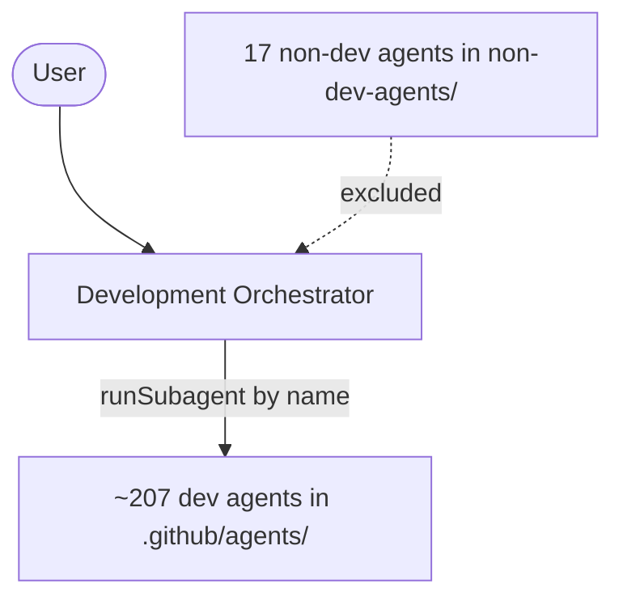

# Development Agent Suite

A GitHub Copilot custom-agent suite: a **Development Orchestrator** (umbrella agent) that
delegates work to a large roster of specialized development sub-agents.

## Layout

| Path | Contents |
|------|----------|
| [.github/agents/](.github/agents) | The **Development Orchestrator** plus ~207 specialized dev agents (`*.agent.md`). |
| [.github/copilot-instructions.md](.github/copilot-instructions.md) | Shared ground rules auto-applied to every agent. |
| [non-dev-agents/](non-dev-agents) | 17 non-software-development agents (LinkedIn, study mode, ideation, novelty personas, etc.), kept **outside** `.github/agents/` so they are not loaded as delegation targets. |

## How it works

- Each agent is a Markdown file with YAML frontmatter (`name`, `description`, `tools`) and a system prompt.
- Only the **Development Orchestrator** has the `runSubagent` tool. It plans, decomposes a request,
  delegates each task to the best-matching agent **by its exact `name:`**, then integrates and verifies
  the results.
- The orchestrator's routing table
  ([development-orchestrator.agent.md](.github/agents/development-orchestrator.agent.md)) maps domains
  (architecture, backend, frontend, mobile, database, DevOps/IaC, cloud, security, testing, docs,
  migration, MCP, Power Platform, Salesforce, BI) to representative agents.



## First-time setup

After cloning, run the setup script **once** to enable automatic protection:

```bash
# Windows
setup.bat

# Linux / macOS
chmod +x setup.sh && ./setup.sh
```

This does two things:
1. Restores `.github/copilot-instructions.md` if it's missing.
2. Activates Git hooks so the file is **automatically restored** on every future `git pull` or `git checkout` — no manual action needed after the first run.

A GitHub Actions workflow also blocks any PR that removes the file.

## Usage

1. Open this repository in VS Code with GitHub Copilot Chat.
2. Select **Development Orchestrator** in the agent picker.
3. Describe a goal — it will plan, delegate to the relevant experts, and report back.

## Adding an agent

Drop a new `*.agent.md` file into [.github/agents/](.github/agents) with `name`, `description`, and
`tools` frontmatter. Reference it in the orchestrator's routing table by its exact `name:` value so it
becomes a delegation target.
