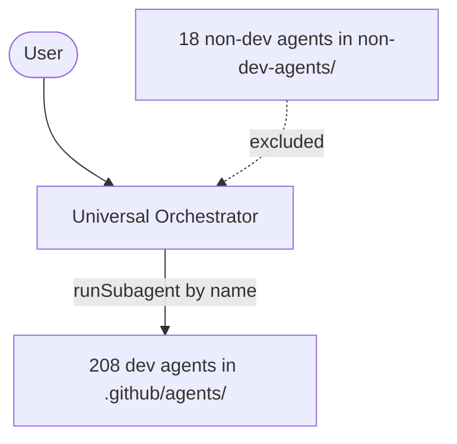

# Development Agent Suite

A GitHub Copilot custom-agent suite: the **Universal Orchestrator** (single entry point) that
delegates work to a large roster of specialized development agents.

## Layout

| Path | Contents |
|------|----------|
| [.github/agents/](.github/agents) | The **Universal Orchestrator** plus 208 specialized dev agents (`*.agent.md`). |
| [.github/copilot-instructions.md](.github/copilot-instructions.md) | Shared ground rules auto-applied to every agent. |
| [non-dev-agents/](non-dev-agents) | 18 non-software-development agents (LinkedIn, study mode, ideation, novelty personas, etc.), kept **outside** `.github/agents/` so they are not loaded as delegation targets. |

## How it works

- Each agent is a Markdown file with YAML frontmatter (`name`, `description`, `tools`) and a system prompt.
- Only the **Universal Orchestrator** (T0) and registered bounded sub-orchestrators (T1, listed in
  [registry/AGENT_REGISTRY.csv](registry/AGENT_REGISTRY.csv)) hold delegation tools. The orchestrator
  delegates each task to the best-matching registered agent **by its exact `name:`**, then validates
  and integrates the result.
- Routing data is generated from the agent files into
  [registry/AGENT_REGISTRY.csv](registry/AGENT_REGISTRY.csv) (machine source) and
  [AGENT_INDEX.md](.github/agents/AGENT_INDEX.md) (human view). Rules:
  [universal-orchestrator.agent.md](.github/agents/universal-orchestrator.agent.md) and
  [governance/](governance).



## First-time setup

After cloning, run the setup script **once** to enable automatic protection:

```bash
# Windows
setup.bat

# Linux / macOS
chmod +x setup.sh && ./setup.sh
```

This does two things:
1. Restores `.github/copilot-instructions.md` from git if it's missing.
2. Activates Git hooks so the file is **automatically restored** on every future `git pull` or `git checkout` — no manual action needed after the first run.

A GitHub Actions workflow (`.github/workflows/agent-integrity.yml`) runs the integrity tests, which fail if the file is missing.

## Usage

1. Open this repository in VS Code with GitHub Copilot Chat.
2. Select **Universal Orchestrator** in the agent picker.
3. Describe a goal — it will plan, delegate to the relevant experts, and report back.

## Adding an agent

Drop a new `*.agent.md` file into [.github/agents/](.github/agents) with `name`, `description`, and
`tools` frontmatter (do not add `agent`/`runSubagent` tools; delegation is limited to T0/T1). Then run
`python scripts/registry_build.py` to regenerate the registry and index, and `python -m pytest tests -q`.
